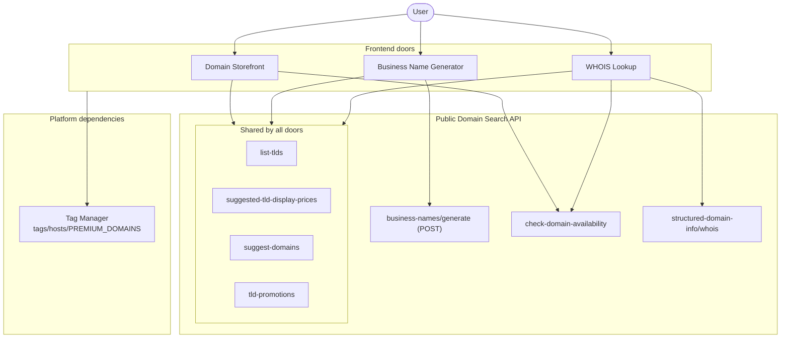

# Wix Domain Search Architecture

This document gives an overview of four Wix platform services that help users find and evaluate domain names: what each one is responsible for and how they work together. Purchase flows are out of scope.

| Service | Type | Purpose |
| --- | --- | --- |
| Domain Storefront | Frontend door | Lets the user search for a domain name and browse priced suggestions. |
| Business Name Generator | Frontend door | Generates business names from a description and suggests priced domains for each name. |
| WHOIS Lookup | Frontend door | Shows a domain's owner, availability, and registration info, plus alternative domains. |
| Public Domain Search API | API layer | The logical name for the endpoints that the doors call, served under several path prefixes on `https://www.wix.com`. |

All three doors share four endpoints: `list-tlds`, `suggested-tld-display-prices`, `suggest-domains`, and `tld-promotions`. The other endpoints are door-specific:

- `business-names/generate` is used only by the Business Name Generator.
- `check-domain-availability` is used by the Domain Storefront and WHOIS Lookup.
- `structured-domain-info/whois` is used only by WHOIS Lookup.

All three doors also depend on the platform's [Tag Manager](#tag-manager), which isn't part of the domain logic.

## System Diagram

## Frontend Doors

Each door adds prices to the domain suggestions it displays. See [Pricing](#pricing) for how.

### Domain Storefront

1. The user types a domain name, including a TLD. The page offers a list of clickable suggested TLDs, which likely come from `tld-promotions` (inferred). Clicking a suggested TLD adds it to the typed name, or replaces the TLD the user typed. The user can also enter their own TLD.
2. The user presses Enter.
3. The page checks the domain with `check-domain-availability`. This step's position in the flow is inferred.
4. The page displays a paginated list of suggestions from `suggest-domains`. If there are more results, a load-more option appears at the bottom of the list.
5. Two results appear first, labeled **Best match** and **Great alternative**.

Every result shows its original price and its discount.

### Business Name Generator

This flow is confirmed. The generator likely uses an LLM to produce the names (inferred).

1. The user describes their business in a text box and selects **Generate names**.
2. The page sends the description as the query in a POST request to `business-names/generate`, which returns a list of business names.
3. For each name, the page calls `suggest-domains` with the generated `name` value as `query`.
4. The page displays the names as a clickable list, and the user can navigate between them.
5. Each name shows a paginated list of domain suggestions (domain plus TLD) for that name. Each suggestion shows its original price and its price after discount, and has a **Get it** button for purchasing the domain. The purchase flow itself is out of scope.

For example, the description "grocery store" can produce:

- The name Groovory, with the suggestions `groovory.co.il` and `thegroovory.net`.
- The name Harvest, with the suggestions `harvest.com` and `healthyharvest.net`.

### WHOIS Lookup

The user enters a domain name or URL to check the domain's owner, availability, and registration info.

1. The page checks the domain with `check-domain-availability`.
2. The `available` field determines the result:
   - `available: true`: the domain doesn't exist. The page shows the exact match first, followed by a paginated list of priced alternatives.
   - `available: false`: the domain exists (it's occupied). The page shows its owner and registration info from `structured-domain-info/whois`, plus a list of available alternatives to purchase.

## Public Domain Search API

The Public Domain Search API is the logical name for the endpoints below. They're served under several path prefixes on `https://www.wix.com`.

### Endpoints

| Endpoint | Description | Used by |
| --- | --- | --- |
| `/_serverless/premium-domains-serverless/domain-tlds/list-tlds` | Returns all TLDs | All doors |
| `/_serverless/domains-serverless-services/v1/suggested-tld-display-prices` | Returns suggested TLDs and their prices | All doors |
| `/domain-search/v2/suggest-domains?query={query}&paging.limit={limit}` | Returns paginated domain suggestions for `query`, without prices | All doors |
| `/_serverless/domains-serverless-services/v1/tld-promotions?limit={limit}` | Returns the TLDs the system promotes | All doors |
| `/_serverless/domains-serverless-services/v1/business-names/generate` | POST request that returns generated business names for a description | Business Name Generator |
| `/domain-search/v2/check-domain-availability?domain={domain}` | Returns a domain's availability and premium status | Domain Storefront, WHOIS Lookup |
| `/_serverless/domains-serverless-services/v1/structured-domain-info/whois?domain={domain}&parse={boolean}` | Returns a domain's parsed and raw WHOIS data | WHOIS Lookup |

### Pricing

`suggest-domains` doesn't return prices. The doors get all prices from `suggested-tld-display-prices`, which covers every TLD that `suggest-domains` can return. Each suggestion's price comes from its TLD: the door looks up the suggestion's TLD in the price list from `suggested-tld-display-prices`.

## Platform Dependencies

### Tag Manager

All three doors call `/_api/tag-manager/api/v1/tags/hosts/PREMIUM_DOMAINS`. This endpoint isn't part of the domain logic or the Public Domain Search API. It's a platform dependency.

Its response suggests that it provides tag manager configuration for the `PREMIUM_DOMAINS` host, and that the doors use it to decide which tracking and marketing tags they can load (inferred).
